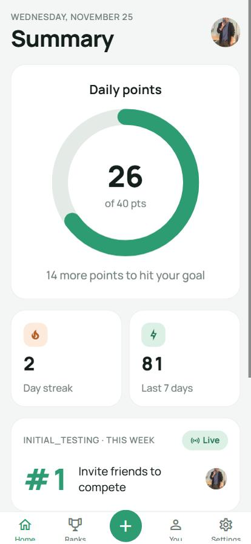
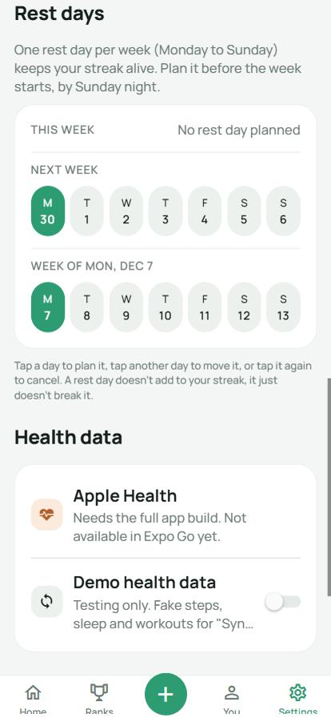
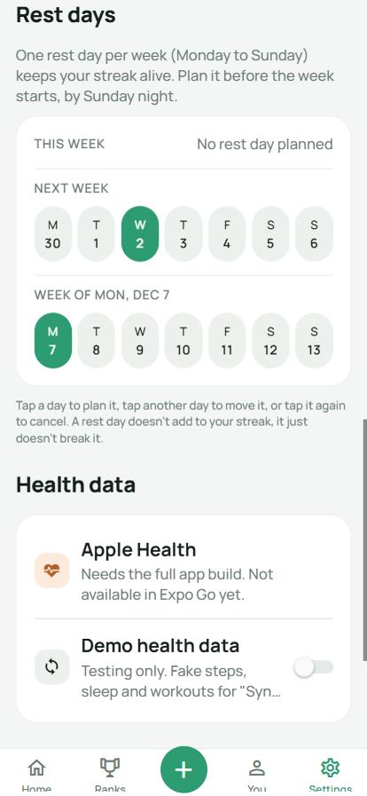
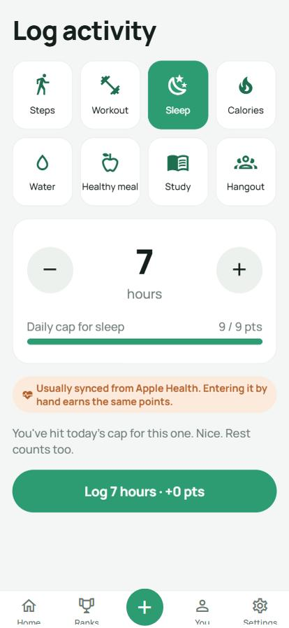
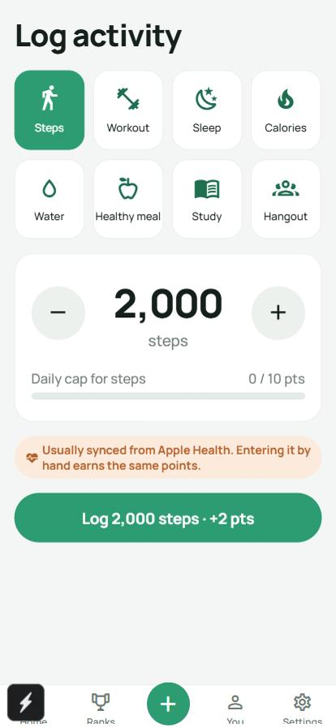
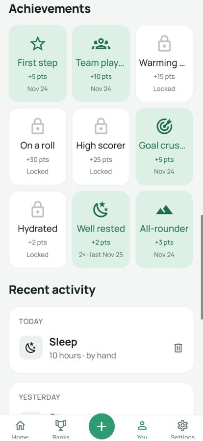

# Point mechanics (Nov 2026)

What changed in how points, streaks and rest days work, with screenshots from the app (web build at phone size, test account). Database script: `supabase/migrations/20261127000000_point_mechanics.sql`.

| | |
|---|---|
|  | **Home.** Today's points and the last 7 days now include achievement points, added on the day each badge was earned. The streak counts days with at least 10 points; a planned rest day keeps it alive. |
|  | **Settings → Rest days.** One rest day per week (Monday to Sunday), planned before that week starts (by Sunday night). The next two weeks are shown. |
|  | **Moving a rest day.** With one rest day per week, tapping another day in the same week moves it there in one tap (here Mon 30 → Wed 2). Tapping the planned day again cancels it. |
|  | **Sleep.** 1 point per hour, capped at 9. 10 hours logged today shows 9 / 9 pts. |
|  | **Typed-in entries earn full points.** 2,000 steps entered by hand previews +2 pts (it was +1 before). Each activity's daily cap still applies. |
|  | **Achievements.** Each badge shows its point value; earned badges now add those points to that day's total and to every leaderboard. |

All point values are placeholders. They live in the `activity_types`, `achievements` and `scoring_rules` tables, mirrored in `src/config/scoring.ts`.
